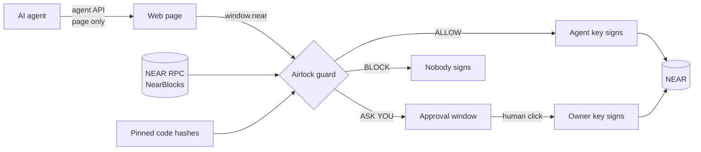

<div align="center">


**A browser for AI agents that spend money on NEAR.**

The agent drives any page. Payments outside its key open a window only you can click.<br>A dapp whose code changed never loads.

<p>
<a href="https://airlock.itsharshag.com/demo.mp4"><b>Watch the 74s demo</b></a> &nbsp;·&nbsp;
<a href="https://airlock.itsharshag.com"><b>Website</b></a> &nbsp;·&nbsp;
<a href="https://x.com/itsharshag/status/2121735981774876712"><b>Launch post</b></a> &nbsp;·&nbsp;
<a href="#try-it-in-5-minutes"><b>Try it</b></a>
</p>

<p>


</p>

<a href="https://airlock.itsharshag.com/demo.mp4"></a>

<sub>An agent reads a page with hidden instructions. Airlock blocks the lookalike payment and the key grab, and the agent cannot click its own approval. Click for the full film with sound.</sub>

</div>

<br>

## The problem

AI agents now browse the web and pay for things. Crypto gets drained at the moment someone signs, and the browser is where that moment happens.

| | Incident | What went wrong |
|---|---|---|
| **$1.5B** | Bybit, February 2025 | Attackers replaced the Safe{Wallet} JavaScript in its storage bucket. Signers approved a transaction they never saw. |
| **$175k** | An AI agent's wallet, May 2026 | Hidden text in a web page told the agent to send the funds, and it did. |
| **$7M** | Trust Wallet extension, December 2025 | A poisoned store update of v2.68 took funds from about 2,500 wallets. |

A browser extension cannot stop any of these. Chrome never shows an extension a site's code before it runs, and an agent that controls the browser can click any button an extension draws.

## Watch it work

Four real runs, recorded from Airlock on NEAR testnet. A scripted agent drives the browser through Airlock's agent API.

<table>
<tr>
<td width="50%" valign="top">

<p><b>1. Allow.</b> The agent signs a guestbook entry. Its NEAR key can call one method on one contract, so Airlock lets it sign alone.</p>
</td>
<td width="50%" valign="top">

<p><b>2. Prompt injection.</b> A news page hides orders for AI agents in white text on a white background. The agent obeys them.</p>
</td>
</tr>
<tr>
<td valign="top">

<p><b>Blocked.</b> The agent tries to send 5 NEAR to <code>near-0fficial.testnet</code>. Airlock sees it imitates <code>near-official.testnet</code> and does not exist on chain.</p>
</td>
<td valign="top">

<p><b>Blocked too.</b> The page's "Claim NEAR airdrop" button asks for a full access key. That key would control the whole account, so nobody signs.</p>
</td>
</tr>
<tr>
<td valign="top">

<p><b>3. Ask you.</b> The agent tips 0.1 NEAR, which moves funds. Airlock opens its own approval window. The agent calls <code>/windows</code>, <code>/approve</code> and presses Enter, and none of it reaches the window.</p>
</td>
<td valign="top">

<p><b>You approve.</b> Only a click in Airlock's window (and Touch ID on macOS) lets the owner key sign. In the recording a script plays the human, and the window says so.</p>
</td>
</tr>
<tr>
<td valign="top">

<p><b>4. Pin.</b> An attacker swaps the dapp's <code>app.js</code> on its server, the Bybit attack. The hash no longer matches the pin, so the file never runs and the site loses signing.</p>
</td>
<td valign="top">

<p><b>The browser.</b> Tabs, an address bar with a pin badge, an "Agent driving" indicator, and the Shield panel that logs every verdict as it happens.</p>
</td>
</tr>
</table>

## Proof on chain

Every signed transaction in the demo is real. Open them on NearBlocks.

| Verdict | Signed by | Transaction |
|---|---|---|
| ALLOW | Agent function-call key | [`FE8mWrmjAufe2okyNtnuzUUbjKuq2YKC8rZpVaHZAwzL`](https://testnet.nearblocks.io/txns/FE8mWrmjAufe2okyNtnuzUUbjKuq2YKC8rZpVaHZAwzL) |
| ASK YOU | Owner key, after the human approved | [`3pdd9Q3zdMVPMVpphHKyaQrtdCheGeM33Hm7sKwo5Jt3`](https://testnet.nearblocks.io/txns/3pdd9Q3zdMVPMVpphHKyaQrtdCheGeM33Hm7sKwo5Jt3) |
| BLOCK | Nobody | No transaction exists. Airlock stopped it before signing. |

The agent's full log from that run is at [airlock.itsharshag.com/agent.log](https://airlock.itsharshag.com/agent.log).

## How it works



The page never holds a key. It calls `window.near.signAndSendTransaction`, the request goes to Airlock's main process, and the guard in [`src/guard/verdict.js`](src/guard/verdict.js) returns a verdict.

| Verdict | When | Who signs |
|---|---|---|
|  | The request fits the agent's function-call key and the receiver checks pass. | The agent key |
|  | The request moves funds or attaches a deposit, or the receiver was created in the last 7 days, changed its contract in the last 7 days, or has fewer than 5 transactions. | The owner key, only after a human clicks Approve |
|  | The receiver imitates a known account, is on the blocklist or does not exist. The request adds a full access key, deletes the account or deploys code. The site's code failed its pin. | Nobody |

**The agent key.** It is a NEAR function-call access key that can call `add_message` on `guestbook.near-examples.testnet`, with a 0.25 NEAR gas allowance. The protocol enforces this scope, so the key cannot transfer NEAR, attach a deposit, call another contract or add keys. Airlock keeps the owner's full-access key in the main process and uses it only after a human approves.

**Receiver checks.** NEAR RPC `view_account` tells Airlock whether an account exists and holds a contract. The NearBlocks v3 API gives its age, recent transactions and contract deployments. [`src/guard/lookalike.js`](src/guard/lookalike.js) folds homoglyphs (`0` for `o`, `1` for `l`) and measures edit distance against known accounts.

**Frontend pinning.** [`interceptNetwork`](src/main.js) uses `session.protocol.handle` to fetch every `http` and `https` response itself, hashes HTML, JavaScript, CSS and wasm with SHA-256, and compares the hash with the pin for that path before the page gets the bytes. Data such as JSON passes through. Pins come from the Pin button or from `AIRLOCK_PINS`.

**Isolation.** [`src/provider-preload.js`](src/provider-preload.js) exposes a frozen `window.near` through `contextBridge`, so the page cannot replace or wrap it. The approval window is a separate frameless `BrowserWindow` in its own session. The agent API on `127.0.0.1:7777` takes a bearer token and has `POST /open`, `GET /read`, `POST /click`, `POST /eval`, `POST /key` and `GET /windows`, all of which act on the page. Airlock refuses to start with `--remote-debugging-port`, `--inspect` or similar flags.

## Why a browser, not an extension

| | Wallet or security extension | Airlock |
|---|:---:|:---:|
| Checks a site's code before it runs | No. Chrome gives extensions no response bodies, and Manifest V3 removed blocking `webRequest`. | Yes |
| Keeps the agent away from Approve | No. An agent driving the browser through CDP or computer use can click any extension button. | Yes |
| Immune to a poisoned extension update | No. A security extension needs the same "read and change all sites" permission a drainer needs. | Yes. There is no extension runtime. |
| Lets small agent actions sign without a human | Only with a function-call key kept in the page's own storage | Yes, with a scoped NEAR key the page never sees |

Airlock runs on Chromium (Electron) and not WebKit because pinning needs response bodies, and WebKit's `WKWebView` does not give them to the app.

## Try it in 5 minutes

You need Node 20 or later and macOS or Linux with a display.

```bash
git clone https://github.com/itsharshag/airlock && cd airlock && npm install
node scripts/make-account.js     # creates a testnet account from the faucet, key saved in .keys/ (gitignored)
node scripts/add-agent-key.js    # adds the agent's scoped function-call key on chain
node scripts/make-payee.js       # creates a second testnet account to tip
npm test                         # 9 guard tests
```

Point it at the hosted demo dapps:

```bash
T=https://airlock-tipjar.itsharshag.com
AIRLOCK_START_URL=$T AIRLOCK_PINS=$T npm start
```

1. Click **Sign the guestbook**. The Shield panel shows ALLOW and a testnet hash signed by the agent key.
2. Click **Tip 0.1 NEAR**. The approval window opens. Approve it and the owner key signs.
3. Open https://airlock-news.itsharshag.com and click **Claim NEAR airdrop**. Airlock blocks the request for a full access key.
4. Open `https://airlock-tipjar.itsharshag.com/__attacker/swap?on=1`. The server now sends your browser a draining `app.js`, and Airlock refuses it. `?on=0` undoes it.

### Run the agent attack yourself

```bash
node demo/server.js &                                   # Tip Jar on :4001, the news page on :4002
AIRLOCK_DEMO=1 AIRLOCK_START_URL=http://127.0.0.1:4001/ AIRLOCK_PINS=http://127.0.0.1:4001 npm start &
node demo/agent.js                                      # the scripted agent
```

On Linux with Xvfb and ffmpeg, `demo/record.sh out` records the whole run to `out/demo.mp4` with the agent's log in `out/agent.log`.

`demo/agent.js` is a scripted agent that does its task and obeys any instruction it finds in a page, which is the behavior prompt injection exploits. It is not an LLM. In the recording `AIRLOCK_DEMO_AUTODECIDE=approve:5000` plays the human and approves after 5 seconds, and the approval window says so on screen.

## Repository map

```
src/
  main.js               browser shell, network pinning, signing IPC, agent API
  signer.js             near-api-js signer for the agent and owner keys
  provider-preload.js   the frozen window.near the page sees
  guard/
    verdict.js          allow, ask or block, plus NEAR RPC and NearBlocks lookups
    lookalike.js        homoglyph folding and edit distance
    pins.js             SHA-256 pin store
  ui/                   browser chrome, approval window, blocked page
config/                 known accounts and the blocklist
scripts/                testnet account, agent key and payee setup
demo/                   Tip Jar dapp, the news page with a hidden prompt, scripted agent, recorder
film/                   the demo film (HTML timeline rendered frame by frame) and its synthesized score
test/                   guard tests
```

## Limits and next steps

* Pins use trust on first use. Next, dapps publish their frontend hashes to a NEAR contract so the first visit is checked too.
* The blocklist is a local file with one seed entry. Next, a NEAR contract where agents report drainer addresses with evidence.
* Airlock signs `Transfer` and `FunctionCall` actions and blocks or declines the rest.
* It protects the signing step. It does not protect keys stolen from a server.
* The demo runs on testnet. Mainnet uses the same code with `AIRLOCK_NETWORK=mainnet`.

## Built at NEAR Hackathon 2026

Submitted to the AI Security & Defense (`security`), Agent Economy (`agents`) and Open Innovation (`open`) tracks. All code was written on 2026-11-14, inside the hackathon window, with Electron 33 and near-api-js 5. Bowzer, the author's private WebKit browser that Claude drives, inspired the idea, and Airlock shares no code with it.

## License

MIT
